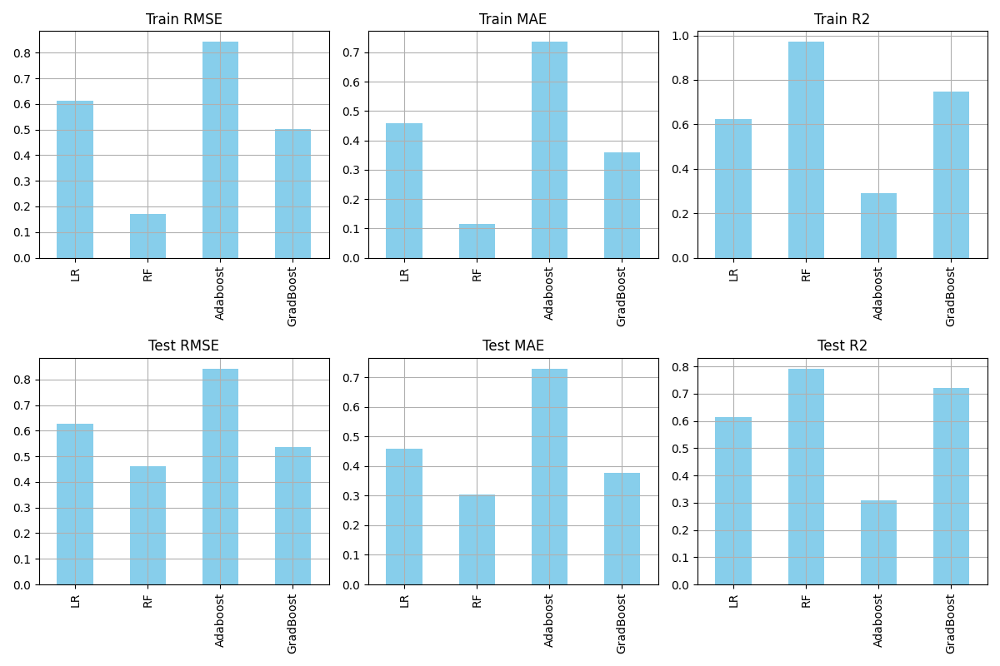

# California House Price Prediction using ML Models

Predicting the median house value of California census districts from location, housing, and income features, and comparing four regression models: Linear Regression, Random Forest, AdaBoost, and Gradient Boosting.

## Dataset

The California Housing dataset (1990 US census), loaded from [akmand/datasets](https://github.com/akmand/datasets). Each row is one census district (block group).

- **Size:** 20,640 rows, 9 numeric features + 1 categorical feature
- **Target:** `median_house_value` (in US dollars)
- **Features:** `longitude`, `latitude`, `housing_median_age`, `total_rooms`, `total_bedrooms`, `population`, `households`, `median_income`, `ocean_proximity`
- A local copy is in `data/california_housing.csv`.

## Project Structure

```text
regression1/
├── README.md
├── requirements.txt
├── .gitignore
├── data/
│   ├── california_housing.csv     # raw data
│   └── processed.csv              # output of the EDA notebook
├── notebooks/
│   ├── 01_eda.ipynb               # exploration + preprocessing
│   └── 02_modeling.ipynb          # model training, comparison, tuning
└── reports/
    └── model_metrics.png          # model comparison chart
```

## Workflow

### 1. EDA and Preprocessing (`01_eda.ipynb`)
- Checked data types, distributions, and missing values (`total_bedrooms` had missing values, filled with the median).
- Explored the relationship between income, location, and price (scatter plots, correlation heatmap).
- Detected outliers with the IQR method (1.5 × IQR) and removed them.
- Standardized numeric columns and one-hot encoded `ocean_proximity`.

### 2. Modeling (`02_modeling.ipynb`)
- 90/10 train/test split (`random_state=42`).
- Trained and compared Linear Regression, Random Forest, AdaBoost, and Gradient Boosting.
- Evaluated with MAE, RMSE, and R² on both train and test sets.
- Tuned Random Forest with GridSearchCV (5-fold CV over `n_estimators` and `max_depth`).

## Results

| Model | Test RMSE | Test MAE | Test R² |
| :--- | :---: | :---: | :---: |
| **Linear Regression** | 0.6285 | 0.4573 | 0.6154 |
| **Random Forest** | **0.4676** | **0.3061** | **0.7871** |
| **AdaBoost** | 0.8412 | 0.7279 | 0.3111 |
| **Gradient Boosting** | 0.5366 | 0.3760 | 0.7196 |
| **Random Forest (tuned)** | 0.4675 | 0.3060 | 0.7847 (CV) |

### Model Comparison


**Takeaways:**
- **Best Performer:** **Random Forest** achieved the best overall performance with the lowest Test RMSE (0.4676) and highest Test R² (0.7871), closely followed by Gradient Boosting (R² of 0.7196).
- **Underperformer:** **AdaBoost** struggled significantly with this regression dataset (Test R² of 0.3111, Test RMSE of 0.8412).
- **Feature Importance:** Median income and location coordinates (latitude and longitude) demonstrated the highest predictive correlation with median house values.

## Limitations

- **Price cap:** `median_house_value` is capped at $500,000 in this dataset, so the model cannot learn true prices for the most expensive districts.
- **Outlier removal:** About 15% of rows were removed as outliers, so reported scores describe the cleaned data, not every district.
- **Preprocessing order:** Imputation, outlier removal, and scaling were done before the train/test split, so test-set statistics influenced preprocessing. A leak-free version would fit these steps inside a Pipeline on the training data only.
- **Random split:** Neighbouring districts can land in both train and test, which can make location-based predictions look better than they would on a genuinely new area.
- **Old data:** The data is from 1990 and does not reflect current prices.

## Future Improvements

- Move preprocessing into a scikit-learn Pipeline to remove data leakage.
- Add engineered features (rooms per household, bedrooms per room, distance to coast or major cities).
- Add a baseline and stronger models (HistGradientBoosting, XGBoost, LightGBM).
- Use cross-validation and a location-based split for evaluation.
- Error analysis and feature importance plots.

## How to Run

```bash
git clone https://github.com/Heybirader/California-House-Price-Prediction-using-ML-Models.git
cd California-House-Price-Prediction-using-ML-Models
pip install -r requirements.txt
```

Run the notebooks in order:
1. `notebooks/01_eda.ipynb`
2. `notebooks/02_modeling.ipynb`

## Tech Stack

Python, pandas, NumPy, scikit-learn, Matplotlib, Seaborn